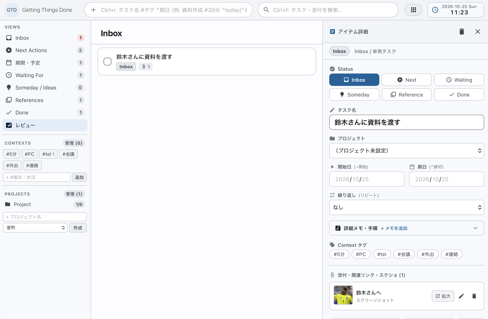
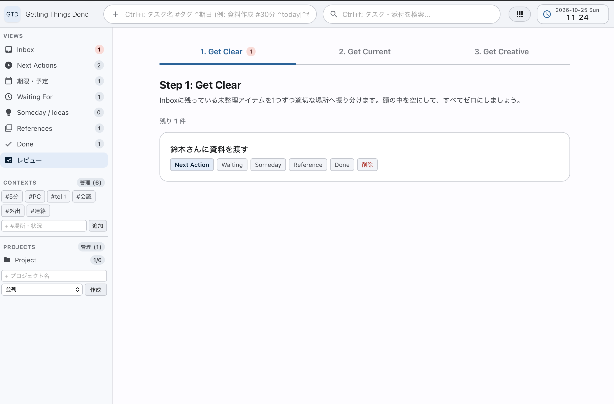
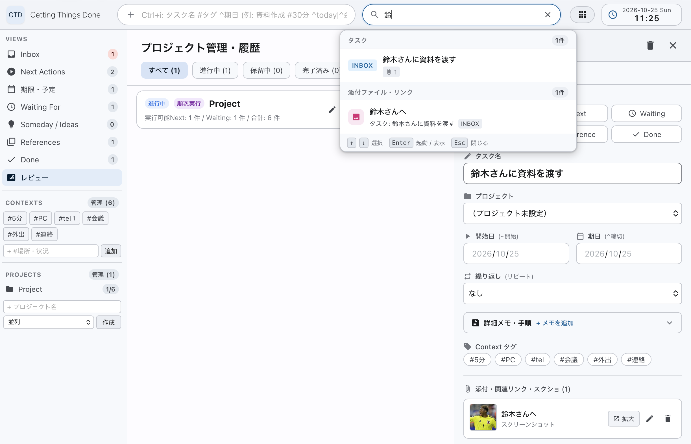

# GTD (Getting Things Done) タスク管理ツール

[](https://github.com/masapico/gtd/actions/workflows/release.yml)
[](https://github.com/masapico/gtd/releases/latest)

シングルバイナリ・**完全な個人向け**GTDタスク・情報管理ツールです。

Goで描かれたGTDサーバーが、WebUIを提供します。



---

## 主な機能

- **3ペインUIによる快適なGTDワークフロー**
  - **Quick Capture (Smart Add)**: 画面上部から即座にインボックスへ投入。`#コンテキスト`、`^期日`、`~開始日` のスマート入力に対応（例: `資料作成 #PC ^金 ~明日`。日付は `today` / `tomorrow` / 曜日 / `10/31` / `+3d` などが使える）。登録後は解釈結果がトーストで表示される。
  - **ステータス管理**: Inbox（未整理）、Next Actions（次にやる行動）、Waiting（連絡待ち）、Someday（いつかやる）、Reference（資料・メモ）、Done（完了）。
  - **予定・期限ビュー (Scheduled)**: 期限超過、今日、明日、今後7日間、開始待ちタスクを自動グルーピング（未来の開始日タスクはNext Actionsから自動除外）。
  - **詳細インスペクタ（右ペイン）**: 本文メモ、期限・開始日、プロジェクト、コンテキストの編集および自動保存。
  - **元に戻す**: 完了・ステータス変更・削除の直後に表示される Snackbar の「元に戻す」で取り消せる（削除は 5 秒間保留してから確定）。
  - **キーボード操作**: `j` / `k` で選択、`Enter` で詳細、`x` で完了、`1`〜`5` でステータス移動、`?` でショートカット一覧。
- **週次レビューウィザード**
  - GTDの形骸化を防ぐ3ステップのレビュー画面。Next Actionsが0件の「停滞プロジェクト」を自動抽出。
  
  

- **オムニサーチ & アプリケーションランチャー**
  - **オムニサーチ (`Ctrl + F`)**: タスク、プロジェクト、メモ、ランチャーを横断したリアルタイム検索。
  - **アプリランチャー (`Ctrl + L`)**: よく使うローカルアプリやURLを登録し、ブラウザ上からワンクリック起動。
  
  

- **添付ファイル・画像ペースト**
  - **スクショ貼り付け (`Ctrl + V`)**: クリップボード内の画像をローカル（`data/images/`）に自動保存・プレビュー表示。
  - **ファイル・URL起動**: ローカルパス（`C:\...` や `\\server\...`）やWeb URLをOSの既定アプリで直接起動。
- **アラーム・作業タイマー**: ヘッダー部から利用できるカウントダウンタイマー。
- **軽量・高ポータビリティ**
  - Go標準の `embed` により全アセット（htmx、CSS、テンプレート）を単一バイナリに内包。
  - CGO不要（Pure Go SQLite: `modernc.org/sqlite`）かつCDN不使用で、完全オフライン環境でも動作。

---

## コマンド一覧

### 1. Webサーバーの起動（通常起動）
```bash
# ビルド済みバイナリの場合
./gtd

# Goソースコードから直接実行する場合
go run main.go
```
起動後、ブラウザで [http://localhost:8080](http://localhost:8080) にアクセスしてください。  
※ポート番号を変更する場合は環境変数 `PORT=xxxx ./gtd` を指定します。

### 2. バックアップコマンド
```bash
# ビルド済みバイナリの場合
./gtd backup

# Goソースコードから直接実行する場合
go run main.go backup
```
- **無停止オンラインバックアップ**: Webサーバーが起動中（WALモード）であっても、SQLiteの `VACUUM INTO` を用いてロックやデータ破損なしに安全にスナップショットを取得します。
- **ZIPアーカイブ作成**: データベース（`data/gtd.db`）と貼り付け画像フォルダ（`data/images/`）をひとまとめにし、`backup/YYYYMMDDHHMMSS_gtd.zip` として保存します。
- **実行結果の確認**: 処理時間、ZIPファイルサイズ、含まれる画像ファイル数が出力されます。

### 3. バージョン情報の確認
```bash
./gtd version
```

### 4. ヘルプ表示
```bash
./gtd help
```

---

## 配布用リリースパッケージの作成

各プラットフォーム（macOS, Windows, Linux）向けのシングルバイナリおよび配布用 `.zip` を一括生成します。

```bash
# 全プラットフォーム向けパッケージを一括作成
./release -version v1.0.0

# または go run から直接実行
go run ./cmd/release -version v1.0.0
```

### 生成されるファイル (`dist/`)
- `dist/gtd_<version>_darwin_arm64.zip` (macOS Apple Silicon)
- `dist/gtd_<version>_darwin_amd64.zip` (macOS Intel)
- `dist/gtd_<version>_windows_amd64.zip` (Windows 64-bit)
- `dist/gtd_<version>_windows_arm64.zip` (Windows ARM64)
- `dist/gtd_<version>_linux_amd64.zip` (Linux 64-bit)
- `dist/gtd_<version>_linux_arm64.zip` (Linux ARM64)
- `dist/checksums.txt` (SHA256 チェックサム一覧)

各 ZIP アーカイブには、実行可能バイナリ（Unix系は実行権限保持）と `README.md` が同梱されます。
特定OSやアーキテクチャのみビルドしたい場合は `-os` / `-arch` オプションが利用可能です：
```bash
./release -version v1.0.0 -os windows -arch amd64
```

### GitHub Actions による自動リリース
`v1.0.0` のようなタグを push すると、[release ワークフロー](.github/workflows/release.yml) がテスト → 全プラットフォーム向けビルドを行い、zip と `checksums.txt` を添付した GitHub Release を自動作成します（`v1.1.0-rc1` のようにハイフンを含むタグはプレリリース扱い）。
```bash
git tag v1.0.0
git push origin v1.0.0
```
